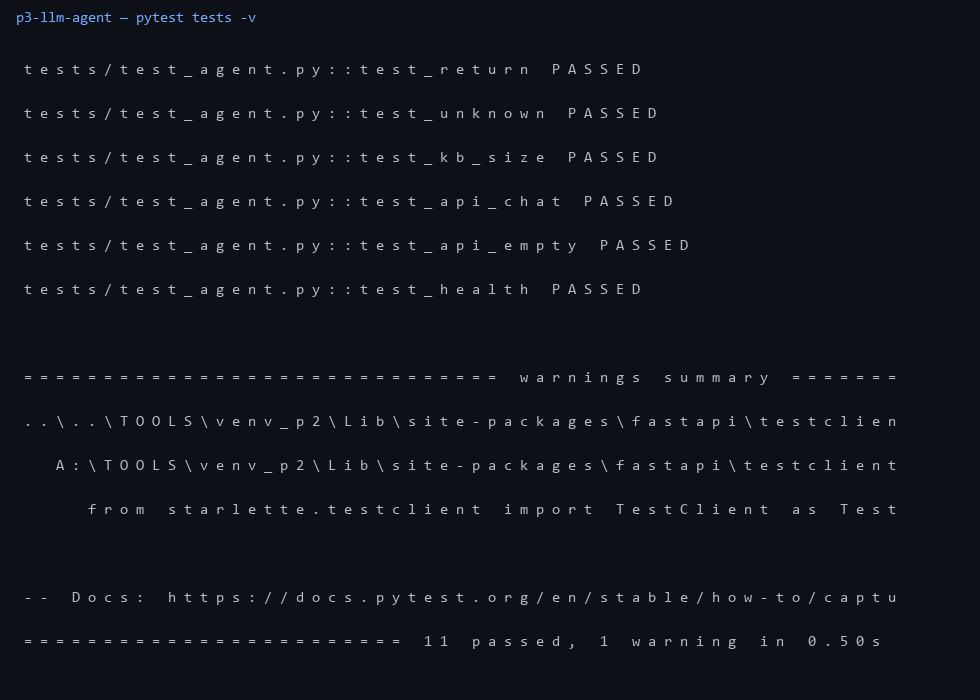

# p3-llm-agent — поддержка с RAG и tools, без GPU

Проект под вакансию с Хабр Карьеры: **Data Scientist / AI Engineer (LLM, AI-агенты)**.
Честно про железо: на Vega 8 без CUDA большие модели не гоняю, поэтому тут
легковесный агент — свой TF-IDF поиск + tools. След. шаг — MiniLM/rubert-tiny на CPU.

## что внутри

- `kb/` — 4 дока базы знаний (оплата, доставка, возврат, контакты)
- `agent/rag.py` — tf-idf + косинус, свой, без зависимостей
- `agent/tools.py` — безопасный калькулятор через ast (без eval)
- `agent/bot.py` — пайплайн: калькулятор → поиск → ответ с источником → фолбэк
- `api.py` — `POST /api/chat` (ответ + хиты с оценкой), `GET /api/health`
- `k8s/` — deployment (2 реплики, readinessProbe) + service, пример для кластера
- `tests/` — 11 тестов: tools, поиск по каждому доку, фолбэк, API

## запуск

```bash
A:\TOOLS\venv_p2\Scripts\python -m pytest tests -v
A:\TOOLS\venv_p2\Scripts\python -m agent.bot
A:\TOOLS\venv_p2\Scripts\python -m uvicorn api:app --port 8073
```

## прогон



`11 passed`
